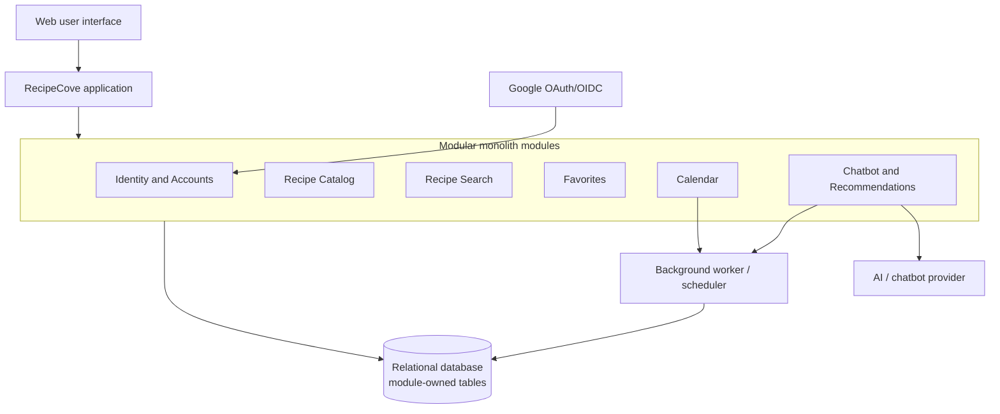

# Architecture Decision Record: RecipeCove Application Architecture

- **Status:** Accepted for the initial implementation
- **Date:** 2026-10-29
- **Decision owners:** RecipeCove project team
- **Scope:** Initial architecture for the RecipeCove web application

## Context

RecipeCove is a web application for discovering recipes and ingredients. Visitors
can search for recipes, view recipe and ingredient information, and receive
diet-based suggestions from a chatbot. Registered users can log in, view their
profiles, manage favorite recipes, create calendars, and schedule recipe-related
events.

The application must integrate with Google authentication and an AI/chatbot
provider. It must persist users, recipes, ingredients, favorites, calendars, and
calendar events. The current requirements do not specify high traffic volumes,
multiple development teams, independent deployment needs, or strict availability
targets.

The architecture therefore needs to:

- Keep the initial system understandable and affordable to build.
- Protect user-specific data through clear ownership and access control.
- Support reliable recipe search, favorites, and calendar operations.
- Isolate slow or unreliable external integrations, especially the chatbot.
- Leave a practical path for scaling or extracting components later.

Important requirements are still open, including the recipe data source, exact
chatbot behavior, reminder and notification behavior, expected scale,
performance targets, supported platforms, and privacy requirements.

## Decision drivers

1. The current feature set is moderate and is likely to be implemented by a
   small team.
2. Core operations such as favorites and calendar updates benefit from simple
   transactions and immediate confirmation.
3. Google authentication and the chatbot are external dependencies that need
   explicit adapters and failure handling.
4. The architecture should avoid unnecessary operational complexity.
5. Future extraction or independent scaling should remain possible if measured
   demand justifies it.

## Options considered

| Option | Structure and scaling | Complexity | Reliability and consistency | Main benefit | Main cost |
|---|---|---|---|---|---|
| **Modular monolith** | One deployable application; the whole application normally scales together, with workers or replicas used for hotspots | Low to medium; simple local development, deployment, and debugging | Strong local transactions and immediate consistency; shared runtime or database failures can affect several modules | Clear internal separation with low infrastructure cost | Less selective scaling and a risk of module boundaries eroding |
| **Microservices** | Independently deployable services; each service can scale based on its workload | High; requires APIs, service operations, distributed tracing, and multiple deployments | Better resource and fault isolation, but network failures, partial success, and eventual consistency must be handled | Independent scaling, deployment, and team ownership | Distributed-system complexity and higher operational cost |
| **Fully event-driven architecture** | Consumers and workers can scale independently; queues can buffer bursts | Medium to high; requires brokers, consumers, retries, schemas, and observability | Durable events and retries can improve resilience, but delivery is typically at-least-once and eventually consistent | Loose coupling and strong support for asynchronous work | Duplicate or out-of-order events, delayed updates, and harder debugging |

## Decision

RecipeCove will use a **modular monolith with selective event-driven
features**.

The main application will be one deployable system with these logical modules:

- **Identity and Accounts:** Google authentication, sessions, profiles, and
  authorization.
- **Recipe Catalog:** recipes, ingredients, diet labels, and recipe details.
- **Recipe Search:** name search, filtering, sorting, and pagination.
- **Favorites:** adding, removing, and listing a user's favorite recipes.
- **Calendar:** calendars, recipe events, ownership checks, and reminder data.
- **Chatbot and Recommendations:** diet-based suggestions and the AI-provider
  adapter.
- **Notifications/Workers:** optional background processing for reminders and
  other delayed work.

Modules will communicate through explicit application services, interfaces, and
well-defined commands. A module must not directly modify another module's
tables or depend on its internal classes.

The initial persistence strategy is one relational database. Each module owns
its tables even though the tables are hosted in the same database. The database
will use constraints such as a unique `(user_id, recipe_id)` pair for
favorites. Separate databases are not initially required.

The system may use internal events or a small queue for work that does not need
to finish before the user receives confirmation, such as:

- Scheduling reminders.
- Updating recommendation history.
- Sending notifications.
- Updating analytics.
- Processing chatbot jobs.

Core operations remain synchronous when the user needs immediate confirmation.
For example, the Calendar module saves a calendar event before reporting that
the event was created.

### High-level structure

## Rationale and consequences

This option gives RecipeCove clear internal separation with low infrastructure
cost, simple local transactions, fast in-process communication, and easier
development and debugging. It also leaves a path to extract Search or Chatbot
later if measured demand justifies it.

The accepted trade-offs are shared deployment and database resources, less
selective scaling than microservices, and the risk that module boundaries
weaken over time. A worker or queue adds some complexity, but isolates
chatbot and reminder work without requiring a distributed system.

## Example: favorite and calendar flow

When an authenticated user finds a recipe and selects both actions:

1. Recipe Search returns the recipe from the Recipe Catalog.
2. Favorites verifies the user and recipe, then saves a unique
   `(user_id, recipe_id)` favorite.
3. Calendar verifies calendar ownership and saves an event referencing the
   recipe.
4. The application confirms both operations. A background worker later handles
   reminders or notifications.

The favorite and calendar actions are separate commands, so if calendar
creation fails, the favorite remains saved and the user can retry only the
calendar action. If a future requirement makes both actions atomic, the
single database can support a coordinated transaction.

## Reliability and scaling safeguards

The initial implementation should include:

- Strict timeouts for Google and chatbot provider calls.
- Chatbot concurrency limits, rate limits, and per-user quotas.
- A circuit breaker and a fallback to ordinary diet-filtered recipe search.
- A bounded chatbot worker or separate worker process when needed.
- Database indexes, pagination, efficient queries, and bounded connection pools.
- Stable request or reminder identifiers and idempotent retry handling.
- Monitoring for chatbot latency, database usage, queue length, and failed jobs.
- Backups, restore testing, and database availability measures.

If usage grows, the team may add caching, a read replica, a specialized search
index, or a separate worker/service. These changes require evidence from
measurements and updated requirements.

## Implementation challenges

### Module boundaries and data ownership

The team must keep business rules in the owning module and expose stable
interfaces. Direct cross-module table access would create hidden coupling and
make future extraction difficult.

### Google authentication

The Identity module must correctly implement OAuth/OIDC redirects, state and
nonce validation, token validation, secure secret storage, account linking,
session expiration, and failure handling. Google-specific details should stay
behind an adapter.

### Chatbot integration

The Chatbot module must handle provider latency, failures, rate limits, cost,
privacy, unsafe responses, and invalid output. Recommendations should
preferably be grounded in valid RecipeCove recipes. The provider must not be
allowed to exhaust resources needed by search or calendar features.

### Database and search performance

Recipe search and favorite/calendar queries need appropriate indexes and
pagination. The team must monitor query performance and connection usage as
the number of users and recipes grows.

### Reminders and idempotency

Reminder records should be durable and have stable identifiers. A scheduler or
worker must claim work atomically, retry failures in a bounded way, and avoid
duplicate processing. External notification providers may not guarantee true
exactly-once delivery, so the system should target effectively-once behavior
and use provider idempotency keys when available.

### Testing and observability

The project needs unit tests for module rules, integration tests for database
operations, end-to-end tests for important user journeys, and failure tests
for Google and chatbot outages. Logs and metrics should make external calls,
background jobs, and failed operations visible.

## When to reconsider this decision

Reconsider microservices or a more extensive event-driven design if one or more
of these conditions becomes true:

- Measured traffic requires independent scaling of a module.
- Chatbot processing needs resources that cannot safely share the application.
- Multiple teams need independent ownership and deployment.
- Availability requirements require stronger fault isolation.
- The shared database becomes a measured performance or availability bottleneck.
- Search requires a dedicated search platform.
- The product gains requirements for large-scale notifications or integrations.

Any revision should be based on measured workload, failure data, and clarified
quality requirements rather than anticipated growth alone.
