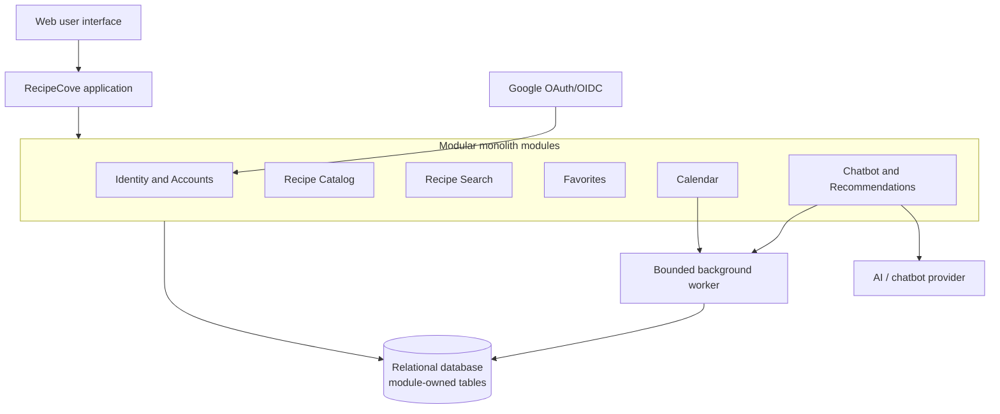

# Architecture Decision Record: RecipeCove Initial Architecture

- **Status:** Accepted for the repeat exercise
- **Date:** 2026-10-29
- **Scope:** Initial architecture for the RecipeCove web application

## Context

RecipeCove helps visitors discover recipes and ingredient information through
name search and diet-based chatbot suggestions. Registered users can log in,
view a profile, manage favorite recipes, create calendars, and schedule
recipe-related events.

The requirements explicitly imply a web application, Google external-account
registration/login, persistent recipe and user data, authenticated personal
features, and a chatbot or recommendation integration. They do not define
traffic volume, response-time targets, availability targets, team structure,
notification channels, recipe data ownership, or the exact chatbot behavior.

The architecture must therefore keep the core user journeys simple and
consistent while isolating external-provider failures and leaving room for
measured growth.

## Decision drivers

1. Simple development, deployment, testing, and operation for the current
   feature set.
2. Clear access control and ownership for profiles, favorites, calendars, and
   events.
3. Immediate consistency for core writes where users expect confirmation.
4. Safe integration with Google and an AI/chatbot provider.
5. Protection of search and calendar functions from slow chatbot work.
6. A practical path to add capacity or extract a component later.

## Options considered

### Option 1: Modular monolith

One deployable application contains explicit modules for Identity and Accounts,
Recipe Catalog, Search, Favorites, Calendar, and Chatbot/Recommendations.
Modules communicate through application services and own their tables in one
relational database. A bounded worker or scheduler handles chatbot jobs and
reminders.

This gives fast in-process calls and simple local transactions. The whole
application normally scales together, although workers, replicas, caching, or
a search index can be added for hotspots. The main risks are shared runtime
resources, database bottlenecks, and module boundaries weakening over time.

### Option 2: Microservices

Identity, Recipe Catalog, Search, Favorites, Calendar, and Chatbot would be
independently deployed services with API or message-based communication.
Each service would preferably own its database or logical data store.

This allows independent scaling, deployment, and fault isolation. It also
introduces network latency and failure, distributed authentication, API
versioning, eventual consistency, more complex testing and observability, and
cross-service workflows for operations such as favorites and calendar events.

### Option 3: Fully event-driven architecture

Core components would publish events through a broker, and consumers would
react asynchronously. Events might include `FavoriteAdded`,
`RecipeEventScheduled`, `RecipeUpdated`, and `UserRegistered`. Workers could
process reminders, notifications, recommendations, analytics, and chatbot
requests.

This decouples producers from future consumers and buffers asynchronous work.
It also introduces eventual consistency, at-least-once delivery, duplicate and
out-of-order messages, schema evolution, retries, dead-letter handling, and
more difficult debugging. It is an interaction style that can be combined
with either a monolith or microservices rather than necessarily replacing
them.

## Comparison

| Criterion | Modular monolith | Microservices | Fully event-driven |
|---|---|---|---|
| Scalability | Scales the application as a unit; workers, replicas, caching, or search indexing can target hotspots | Each service scales independently, but requires more infrastructure | Consumers and workers scale independently; queues buffer bursts |
| Complexity | Low to medium; simple local development and transactions | High; APIs, deployments, tracing, service discovery, and distributed data | Medium to high; broker, consumers, schemas, retries, and monitoring |
| Reliability | Strong local consistency; shared runtime/database failures can affect several modules | Better resource isolation; network and partial-failure handling are required | Retries and durable events help recovery; delivery is usually eventual and at least once |
| Performance | Fast in-process calls; shared resources need limits | Network calls add latency; hotspots can scale separately | Immediate work stays fast, while queued work may be delayed |
| Consistency | One relational database can provide ordinary transactions | Cross-service workflows need sagas, idempotency, or compensation | Consumers may temporarily have stale state |
| Security | Centralized security boundary, but module authorization must be enforced | Each service validates identity and authorization across trust boundaries | Producers, consumers, and broker permissions require protection |
| Operations and cost | Lowest deployment, monitoring, and hosting burden | Highest operational and infrastructure burden | Requires broker/worker operations even without many services |
| Team fit | Fits a small team and unclear scale | Best when teams need independent ownership and deployment | Useful when asynchronous workflows are central |
| Evolution | Modules can later be extracted if boundaries are respected | Flexible independently, but changes cross API/data contracts | Easy to add consumers, but event contracts must be maintained |

## Decision

RecipeCove will use a **modular monolith with selective event-driven
features**.

The application will initially contain these modules:

- **Identity and Accounts:** Google OAuth/OIDC integration, sessions, profiles,
  and authorization.
- **Recipe Catalog:** recipes, ingredients, diet labels, and recipe details.
- **Recipe Search:** name search, filtering, pagination, and sorting.
- **Favorites:** add, remove, and list operations with duplicate protection.
- **Calendar:** calendar ownership, recipe events, and reminder records.
- **Chatbot and Recommendations:** diet suggestions and the provider adapter.
- **Background Worker:** bounded chatbot jobs, reminders, and other delayed
  work.

The modules will use explicit interfaces and module-owned tables. The initial
database will be one relational database, not a collection of separate
databases. A module must not directly modify another module's tables.

The core operation is synchronous when the user needs immediate confirmation.
Events or a queue may be introduced for optional or delayed work such as
reminders, notifications, analytics, recommendation updates, and chatbot
processing.

### Architecture overview

## Rationale and consequences

The modular monolith best fits the current evidence because it minimizes
distributed-system complexity while preserving clear responsibilities,
transactional user operations, and a future extraction path.

Accepted trade-offs are shared deployment and database resources, less
selective scaling than microservices, and the need to enforce module
boundaries. These risks are addressed with bounded worker capacity, provider
timeouts, rate limits, circuit breakers, database indexes, pagination,
idempotent operations, and monitoring.

Microservices are deferred because the requirements do not establish the
traffic, team structure, independent deployment, or fault-isolation needs that
would justify their cost. A fully event-driven default is deferred because
favorites, calendars, and recipe views need clear immediate results and do not
currently require asynchronous coordination.

## Key workflow and failure behavior

When an authenticated user searches for a recipe:

1. Search asks the Recipe Catalog for matching recipes.
2. Favorites verifies the user and recipe, then saves a unique
   `(user_id, recipe_id)` favorite.
3. Calendar verifies calendar ownership and saves an event referencing the
   recipe.
4. The user receives confirmation for each completed operation.
5. A background worker later processes reminders or notifications.

The favorite and calendar actions are separate commands. If the Calendar
operation fails, the saved favorite is not removed; the user receives a clear
error and can retry only calendar creation. Unique constraints and stable
request IDs prevent duplicate favorites or duplicate retried work.

If chatbot or Google calls time out, the application stops waiting after a
bounded period, records the failure, and uses an appropriate fallback or error
message. Chatbot capacity is limited so it cannot consume all resources needed
by search and calendar operations.

## Implementation challenges and safeguards

- **Module boundaries:** keep business rules and table ownership inside the
  responsible module; test that other modules use public interfaces.
- **Google login:** validate OAuth/OIDC state, nonce, tokens, redirects, client
  secrets, account linking, and session expiry behind an identity adapter.
- **Chatbot integration:** validate output, ground suggestions in known recipes
  where possible, enforce timeouts and quotas, control cost, and handle unsafe
  or unavailable provider responses.
- **Database growth:** use indexes, pagination, efficient queries, bounded
  connection pools, backups, restore tests, and database monitoring.
- **Reminders:** store durable reminder records, claim work atomically, retry
  failures in bounded fashion, and make processing idempotent. External
  providers may prevent a mathematical exactly-once guarantee, so target
  effectively-once delivery with provider idempotency keys when available.
- **Testing and observability:** test module rules, database integration,
  external failures, retries, and end-to-end user journeys; expose logs,
  metrics, correlation IDs, and failed-job alerts.

## Open requirements and reconsideration triggers

Clarify the recipe data source and ownership, supported diets, chatbot
behavior, calendar recurrence and notifications, profile/privacy rules,
expected scale, performance and availability targets, supported platforms,
accessibility, and backup/recovery requirements.

Reconsider this decision if measured traffic requires independent scaling,
chatbot work cannot safely share resources, multiple teams need independent
deployment, the database becomes a measured bottleneck, or stronger
availability isolation is required.
